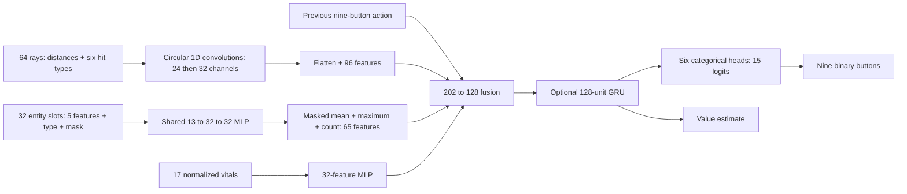

# Architecture and implementation decisions

The policy consumes only the official spatial observation. Its actions come from
trained weights. Absolute position is confined to training-only reward accounting.

The 202 fusion inputs are 96 ray features, 65 pooled entity features, 32 vitals
features and nine previous action bits. Fixed sine/cosine bearing channels encode
each sensor direction; they do not compute aiming actions. Circular convolution
respects the adjacency of ray 63 to ray 0. Flattening preserves directional
information that full angular pooling would discard.

Entity processing is shared across slots. The mask excludes padding from both mean
and maximum; an all-empty set returns zeros without division by zero. Pooling is
permutation tolerant. The agent uses the official fixed padded arrays, not an
invented variable-length list API. Entity attention is not implemented without
evidence that its additional cost improves this baseline.

Vitals preserve separate ammo categories, weapon slot, six key flags and three
velocity components. Conservative scales keep typical magnitudes small. Finite
float32 extremes are clipped before division. RGB/depth are ignored in this
configuration; no claim is made that this beats a controlled visual baseline.

The previous action tells the network whether USE or weapon cycling was held on
the previous step. Both buttons are edge triggered by the vanilla engine. Their
timing is learned; there is no hand-written door cooldown or combat controller.

Forward/back, left/right strafe and left/right turn each use idle/first/second
categorical choices. Attack, USE and next-weapon are independent binary choices.
This removes cancelling opposing commands while preserving simultaneous movement,
turning, firing and interaction. The policy learns every categorical selection.

The GRU compresses sensory history; it does not construct an explicit map and
cannot guarantee backtracking or loop avoidance. Reset clears the hidden vector,
previous action, episode-start mask and local sampling generator. The MLP ablation
uses the same spatial encoders and bypasses recurrence. The selected checkpoint's
`model_config` is the authority for whether the shipped agent has recurrence.

PPO replays contiguous sequences with the stored starting hidden state. A reset
mask is applied inside each unrolled sequence. Gradients are truncated at sequence
boundaries, not between decisions within a sequence. Clipped policy and value
losses, GAE, entropy, advantage normalization, gradient clipping and learning-rate
decay are implemented directly in PyTorch. An analytical test distinguishes
termination from a time limit: death/exit stops bootstrapping; truncation
bootstraps but stops advantage recursion across the reset.

An important wrapper limitation: after an engine terminal tick, `step()` returns
the last available pre-terminal observation. Time-limit bootstrapping therefore
uses that last available observation, which may lag the timeout by four ticks.
The wrapper is preserved unchanged. Reward metrics use its refreshed terminal
game variables. This small bootstrap approximation is disclosed rather than
claiming access to an unavailable final sensory state.

Resume restores model, optimizer, step/update counts, learning schedule position,
PyTorch RNG and map-sampling RNG. It deliberately begins fresh engine episodes and
zero recurrent state; it is not a bit-exact continuation of a partially played
episode. Checkpoints are atomically replaced after each complete PPO update.

The submitted checkpoint omits optimizer state and RNG snapshots to minimize size.
Inference loads it once with `weights_only=True`, then performs no file, engine or
network access. CPU thread count is explicitly one. CUDA is selected only when
the supplied device requests it; no fallback silently overrides the supplied device.
