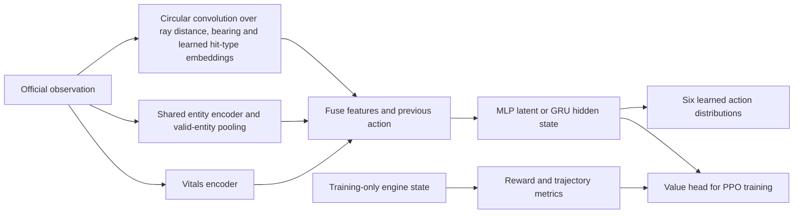

# DOOM NEXUS Phase 2 demonstration

Open the generated `index.html` in a browser. It plays two recorded ViZDoom runs on the same unseen-to-training validation map at the same seed. The slider provides synchronized frame-by-frame inspection. The dashboard reads local PNG atlases and a JavaScript data file, so playback needs no server or network. Keep the files in the dashboard directory together.

The original recordings consist of the native ViZDoom `.lmp` replay, a NumPy RGB frame array, and a compressed JSON decision trace. The dashboard exposes health, armor, ammunition, visible entities, rays, action probabilities, reward, exploration and progression counters. The policy receives the official observations only. Diagnostic counters and positions are collected by the evaluator outside the policy.



The rays describe nearby space from the player's perspective. A small circular convolution looks for patterns in adjacent rays, including an opening or a wall edge. The entity encoder works on visible objects and masks vacant slots. The GRU carries a learned numeric summary across decisions, and resets between maps. No planner or explicit world map is part of the agent.

## Judge questions

**How do actions stay legal?** The network samples six categorical groups. Each opposing movement or turning pair is encoded as one group with an idle option. Independent button groups cover attack, use and weapon switching.

**How do you know the model uses memory?** In a matched 8,192-decision validation experiment, clearing the same GRU's recurrent state every decision reduced its tier-weighted proxy from 29.62 to 13.66 and removed all four episodes' Tier 3 unlocks. The intervention demonstrates useful dependence on state in this experiment. It does not identify a learned map.

**Why use CPU training with a CUDA laptop?** With the batched optimizer, four serial CPU engines reached 339 decisions/sec in the short sweep. CUDA with four environments reached 155 decisions/sec. Windows and WSL share the laptop's resources, and spawned workers consumed nearly 3 GiB combined RSS.

**What still fails?** The historical baseline gauntlet ended in death in four of four episodes. The key scenarios exposed both missed key pickups and a failure to return to or use a locked door after pickup. Show examples with the replay slider and label any unchanged failures in the final comparison.

**How do you avoid leaderboard leakage?** Train maps alone supply rollouts. The original validation split guides model selection. The original test split had already been measured and is diagnostic. The final experiment uses newly seeded maps and reports a local proxy because organizer weights and maps are private.

## Replay a measured success and failure

The 100,000-decision dashboard is at `recordings/phase2/dashboard-100k/index.html`. On validation map `keys/01.wad` with engine and policy seed 1, both policies collected one key and unlocked one door. The preserved baseline timed out. The 100,000-decision MLP reached the exit. This is an illustrative paired example from validation.

Rebuild this comparison with the verified project environment:

```bash
python -m scripts.diagnose_episodes --checkpoint runs/phase2/baseline/best_model.pt --split validation --stage keys --index 1 --seeds 1 --record --trace-dir recordings/phase2/replay-baseline --out runs/phase2/replay-baseline.json
python -m scripts.diagnose_episodes --checkpoint runs/phase2/milestone-100k/latest.pt --split validation --stage keys --index 1 --seeds 1 --record --trace-dir recordings/phase2/replay-100k --out runs/phase2/replay-100k.json
python -m scripts.build_replay_dashboard --baseline recordings/phase2/replay-baseline/keys-01-1 --candidate recordings/phase2/replay-100k/keys-01-1 --comparison benchmarks/phase2/milestone-100k-validation.json --learning runs/phase2/milestone-100k/learning.jsonl --out recordings/phase2/rebuilt-dashboard
```
